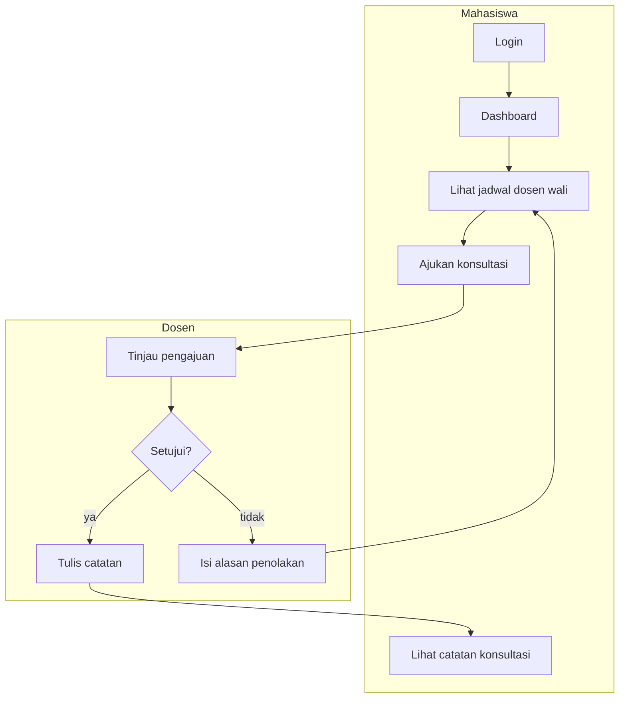

# Sistem Informasi Layanan Konsultasi Akademik

Aplikasi web berbasis **Laravel 13** dengan dukungan **Progressive Web App (PWA)** untuk
mengelola jadwal konsultasi, pengajuan, persetujuan/penolakan, dan catatan hasil
konsultasi antara mahasiswa dan dosen wali.

## Fitur utama

- Autentikasi berbasis peran (mahasiswa/dosen), CSRF, rate limit login, validasi input.
- Jadwal konsultasi: CRUD, deteksi bentrok (slot berdampingan diizinkan), penonaktifan.
- Pengajuan konsultasi: hanya ke dosen wali, jadwal aktif, slot belum lewat; anti double
  booking (transaksi + `lockForUpdate`).
- Persetujuan/penolakan: alasan wajib saat menolak; slot tidak bisa disetujui dua kali;
  guard jadwal aktif & belum lewat.
- Catatan konsultasi: hanya dosen terkait, sekali per pengajuan (unique index), menyelesaikan
  pengajuan.
- Notifikasi database + pemberitahuan perubahan jadwal.
- Dashboard, filter, pencarian, riwayat.
- PWA: manifest, ikon, service worker v3, offline fallback, installable.
- Responsif (1440/1280/768/390/360), dark mode.

## Alur pengguna



Diagram arsitektur lengkap (HTML interaktif):
[arsitektur-konsultasi-akademik.html](.archify/architecture-konsultasi-akademik-20261113-161510/arsitektur-konsultasi-akademik.html).
GitHub tidak merender HTML inline, jadi unduh lalu buka di browser.

## Tumpukan teknologi

Laravel 13, PHP 8.3, MySQL, Tailwind CSS, Vite, PHPUnit.

## Mulai cepat

```powershell
composer install
Copy-Item .env.example .env
php artisan key:generate
# atur DB_* di .env
php artisan migrate --seed
npm install
npm run build
php artisan serve
```

Buka `http://127.0.0.1:8000` (atau `http://localhost:8000`).

## Dokumentasi

- [Panduan Instalasi](docs/INSTALLATION.md)
- [Panduan Pengguna](docs/USER_GUIDE.md)
- [Laporan Pengujian](docs/TESTING_REPORT.md)
- [Pengujian PWA](docs/PWA_TESTING.md)

## Akun demo

Lihat [Panduan Pengguna](docs/USER_GUIDE.md#akun-demo).

## Pengujian

```powershell
php artisan test
```

Hasil rilis ini: **94 test, 381 assertion, 0 gagal**.

## Lisensi

Proyek akademik (UAS). Tidak ada lisensi open-source yang dinyatakan.
